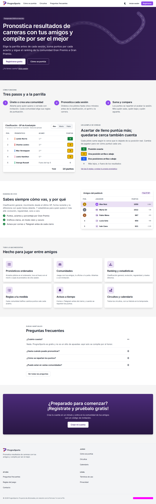
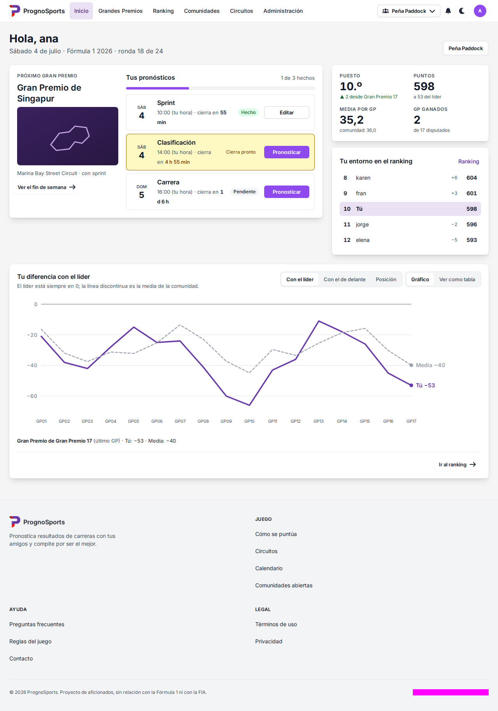

<div align="center">


# PrognoSports · frontend

**Rediseño del frontend de [PrognoSports](https://prognosports.com): pronostica Fórmula 1 con tus amigos, compite en comunidades y sigue el ranking de la temporada.**

[](https://github.com/zugazagoitia/Vivecoded-Prognosports/actions/workflows/ci.yml)
[](https://github.com/zugazagoitia/Vivecoded-Prognosports/actions/workflows/codeql.yml)
[](https://github.com/zugazagoitia/Vivecoded-Prognosports/actions/workflows/deploy.yml)


[Puesta en marcha](#-puesta-en-marcha) ·
[Scripts](#-scripts) ·
[Pruebas](#-pruebas) ·
[CI/CD](#-cicd-y-despliegue) ·
[Documentación](docs/README.md) ·
[Contribuir](#-contribuir)

</div>

---

<div align="center">

|                                                Landing                                                |                                             Inicio                                              |
| :---------------------------------------------------------------------------------------------------: | :---------------------------------------------------------------------------------------------: |
|  |  |

<sub>Capturas de referencia de los tests visuales (tema claro; también hay tema oscuro y versión móvil).</sub>

</div>

---

## 📑 Índice

- [Qué es](#-qué-es)
- [Puesta en marcha](#-puesta-en-marcha)
- [Scripts](#-scripts)
- [Entorno y variables](#-entorno-y-variables)
- [Backend en local (sin secretos)](#-backend-en-local-sin-secretos)
- [Stack y arquitectura](#-stack-y-arquitectura)
- [Feature flags](#-feature-flags)
- [Pruebas](#-pruebas)
- [CI/CD y despliegue](#-cicd-y-despliegue)
- [Ramas y flujo de release](#-ramas-y-flujo-de-release)
- [Contribuir](#-contribuir)
- [Documentación](#-documentación)

## 🏁 Qué es

Frontend nuevo de PrognoSports (Vue 3.5 + Vite + TypeScript estricto) que sustituye al cliente web actual. Consume la **API v2** existente: **el backend y la API no se modifican desde este repositorio** (el backend vive en el repositorio privado `Cadiducho/PrognoSports`; las discrepancias se documentan en [`src/api/README.md`](src/api/README.md) y se reportan allí, ver [`AGENTS.md`](AGENTS.md)).

Incluye landing y páginas públicas, acceso y cuenta, comunidades, calendario y detalle de Gran Premio, pronósticos, ranking y estadísticas, circuitos, perfil y un área de administración. Todo en español, con tema claro/oscuro y diseño responsive y accesible (axe en los tests e2e).

Se despliega en **Cloudflare Workers (Static Assets)**, plan gratuito, sin código de servidor.

## 🚀 Puesta en marcha

Requisitos:

- **Node.js 24** (versión de `.nvmrc`; `engines` exige `>=22`).
- **pnpm 10.34.6**, fijado en `packageManager`. Con Corepack (`corepack enable`) se usa solo la versión correcta.
- Para regenerar capturas de e2e: **Docker** (ver [Pruebas](#-pruebas)).

```sh
git clone https://github.com/zugazagoitia/Vivecoded-Prognosports.git
cd Vivecoded-Prognosports
pnpm install --frozen-lockfile    # instala dependencias y los hooks de git (lefthook)
VITE_API_MOCK=true pnpm dev       # http://localhost:5173 con una API simulada (MSW); no necesitas backend
```

Otras formas de arrancar el desarrollo:

| Quiero…                               | Comando                                                                          |
| ------------------------------------- | -------------------------------------------------------------------------------- |
| Usar la API simulada (MSW)            | `VITE_API_MOCK=true pnpm dev`                                                    |
| Usar la API pública de producción     | `echo 'VITE_API_BASE_URL=https://api.prognosports.com' > .env.local && pnpm dev` |
| Usar un backend local                 | [`docs/local-backend.md`](docs/local-backend.md)                                 |
| Ver el panel de flags como en la beta | `pnpm dev --mode beta`                                                           |
| Probar el build de producción         | `pnpm build && pnpm preview`                                                     |

## 🧰 Scripts

| Script                                             | Qué hace                                                                                                      |
| -------------------------------------------------- | ------------------------------------------------------------------------------------------------------------- |
| `pnpm dev`                                         | Servidor de desarrollo de Vite (modo `development`, lee `.env`).                                              |
| `pnpm build`                                       | `typecheck` + build de producción en `dist/` (`pnpm build --mode beta` para la beta).                         |
| `pnpm preview`                                     | Sirve `dist/` localmente.                                                                                     |
| `pnpm typecheck`                                   | `vue-tsc` sobre la app (`tsconfig.app.json`), los scripts (`tsconfig.node.json`) y `e2e/`.                    |
| `pnpm lint` · `pnpm lint:fix`                      | oxlint + ESLint (con Vue y accesibilidad).                                                                    |
| `pnpm format` · `pnpm format:check`                | Prettier (con el plugin de Tailwind).                                                                         |
| `pnpm test` · `test:watch` · `test:coverage`       | Vitest (unitarios y de componentes, junto al código en `*.test.ts`), con o sin cobertura.                     |
| `pnpm test:contract`                               | Suite de contrato contra la API real (solo lecturas). Ver [`docs/contract-tests.md`](docs/contract-tests.md). |
| `pnpm api:drift` · `api:types` · `api:types:fetch` | Compara/actualiza `api/openapi.json` y regenera `src/api/schema.d.ts`.                                        |
| `pnpm e2e`                                         | Typecheck + build de e2e + Playwright (todos los proyectos).                                                  |
| `pnpm e2e:fast`                                    | Igual, solo `chromium` y `mobile`.                                                                            |
| `pnpm e2e:ui`                                      | Playwright en modo UI.                                                                                        |
| `pnpm e2e:update:linux`                            | Regenera las capturas de referencia en Linux con Docker (**la única forma válida**).                          |
| `pnpm size`                                        | Presupuesto de bundle (ejecutar tras `pnpm build`).                                                           |
| `pnpm analyze`                                     | Build con treemap en `reports/bundle.html`.                                                                   |
| `pnpm check:dist`                                  | Busca patrones de secretos en `dist/`.                                                                        |
| `pnpm check:contrast`                              | Comprueba el contraste de los tokens de diseño.                                                               |

Los hooks de git (lefthook) se instalan con `pnpm install`: `pre-commit` ejecuta oxlint, ESLint y Prettier sobre los ficheros staged; `pre-push` ejecuta `pnpm typecheck`.

## ⚙️ Entorno y variables

Vite tiene tres modos, cada uno con su fichero versionado (solo configuración pública):

| Modo          | Fichero           | Uso                                                                                                                  |
| ------------- | ----------------- | -------------------------------------------------------------------------------------------------------------------- |
| `development` | `.env`            | `pnpm dev`. Apunta a un backend local (`http://localhost:8001`).                                                     |
| `beta`        | `.env.beta`       | Build de `develop` y previews de PR. Banner «Estás utilizando PrognoSports Beta», panel de flags. API de producción. |
| `production`  | `.env.production` | Build de `master`. API de producción y los 12 feature flags activados.                                               |

Los overrides personales van en `.env.local` (ignorado por git). **Nunca pongas secretos en `VITE_*`**: acaban en el bundle.

| Variable                                              | Obligatoria | Descripción                                                                                                      |
| ----------------------------------------------------- | :---------: | ---------------------------------------------------------------------------------------------------------------- |
| `VITE_API_BASE_URL`                                   |     Sí      | Origen de la API **sin** `/v2` (se rechaza si termina en `/v2`). También alimenta el `preconnect`.               |
| `VITE_API_MOCK`                                       |     No      | `true` en `pnpm dev` arranca MSW (`src/mocks`) y no hace falta backend.                                          |
| `VITE_FF_<NOMBRE>`                                    |     No      | Feature flags (12). Solo el literal `true` los activa. Ver [Feature flags](#-feature-flags).                     |
| `VITE_PREVIEW`                                        |     No      | `true` en beta y previews: muestra el panel de flags (en `development` se muestra siempre; nunca en producción). |
| `VITE_SENTRY_DSN`                                     |     No      | DSN de Sentry (público). Sin él, Sentry no se carga. Un DSN malformado se ignora.                                |
| `VITE_CF_ANALYTICS_TOKEN`                             |     No      | Token de Cloudflare Web Analytics (público). Sin él no se inyecta el beacon.                                     |
| `VITE_GIT_SHA` · `VITE_GIT_DATE` · `VITE_APP_VERSION` |     No      | Los calcula `vite.config.ts` desde git y `package.json`; CI los fija para el commit probado.                     |

Las variables se tipan en `src/env.d.ts` y se validan al arrancar con Zod (`src/env.ts`): si falta alguna o es inválida, la app no arranca y nombra la variable en consola y en pantalla. Las variables opcionales tratan la cadena vacía como «no definida» (CI pasa las variables sin definir como `""`).

## 🔌 Backend en local (sin secretos)

Para trabajar contra un backend propio (puerto `8001`, MariaDB, migraciones automáticas) o ejecutar `pnpm test:contract` contra él, sigue [`docs/local-backend.md`](docs/local-backend.md). Resumen: clona el backend, levanta una MariaDB local con credenciales **tuyas** en un `config.json` ignorado por git, `./gradlew run` y `VITE_API_BASE_URL=http://localhost:8001` en `.env.local`. No hace falta ningún secreto del proyecto: ni credenciales de producción ni tokens de Cloudflare.

## 🧱 Stack y arquitectura

| Capa           | Tecnología                                                                                                                                       |
| -------------- | ------------------------------------------------------------------------------------------------------------------------------------------------ |
| Framework      | Vue 3.5 (`<script setup lang="ts">`), Vue Router 5 con rutas por fichero (`unplugin-vue-router`)                                                 |
| Estado         | Pinia (cliente: sesión, comunidad activa, tema) y TanStack Query (servidor)                                                                      |
| Datos          | Cliente `fetch` propio + esquemas Zod 4 (`src/api`), tipos generados desde OpenAPI                                                               |
| UI             | Tailwind CSS 4, Reka UI, vee-validate, vue-sonner; gráficos propios en SVG (`components/charts`) y mapa de circuitos con teselas raster de CARTO |
| i18n           | vue-i18n 11, cadenas en `src/i18n/es/*.json`                                                                                                     |
| Calidad        | Vitest + Testing Library + MSW, Playwright + axe-core, oxlint, ESLint, Prettier, lefthook                                                        |
| Observabilidad | Sentry (opcional, inerte sin DSN), Cloudflare Web Analytics (opcional)                                                                           |
| Despliegue     | Cloudflare Workers Static Assets (`wrangler`), GitHub Actions                                                                                    |

```
src/
  api/          cliente HTTP, esquemas Zod, un módulo por área (auth, communities, gps…), contrato en api/contract
  pages/        rutas por fichero (público, acceso, comunidades, GP, ranking, perfil, admin…)
  layouts/      layouts (landing, app, admin…)
  components/   ui/ (base), data/, charts/, layout/ y componentes de cada área
  queries/      hooks de TanStack Query
  stores/       Pinia (sesión, comunidad activa, tema)
  flags/        feature flags y panel de revisión
  i18n/es/      textos de la interfaz
  mocks/        MSW: handlers y fixtures con la forma REAL de la API
  lib/ utils/ composables/ styles/ content/   utilidades, composables, tokens de diseño y contenidos
  env.ts        entorno validado
e2e/            Playwright (specs, capturas de referencia, mocks de la API)
docs/           documentación (índice en docs/README.md)
scripts/        utilidades de build, presupuesto de bundle, drift de la API, cobertura, smoke de deploy
```

El alias `@/` apunta a `src/`. Las respuestas de la API pasan siempre por los esquemas Zod, y los errores de negocio (HTTP 200 con `success:false`) se convierten en `ApiError` en `src/api/client.ts`. Detalles y decisiones: [`docs/requisitos.md`](docs/requisitos.md) y [`src/api/README.md`](src/api/README.md).

## 🚩 Feature flags

Doce estadísticas opcionales del ranking (Mi temporada, Palmarés, Gap, Bump, Lucha por el título, Regularidad, Cara a cara, Distribución, Mapa de calor, Aciertos por tipo, Puntos por sesión y Percentil entre comunidades) se controlan con `VITE_FF_<NOMBRE>=true`. **Están activadas en `.env.beta` y `.env.production`**; en `.env` (desarrollo) están apagadas por defecto. Con un flag apagado se ocultan rutas, enlaces y peticiones, y su código es un chunk perezoso. En desarrollo, beta y previews se pueden alternar desde el panel de flags (nunca en producción). Referencia completa: [`docs/feature-flags.md`](docs/feature-flags.md).

## 🧪 Pruebas

| Tipo                       | Comando                      | Dónde / notas                                                                                                               |
| -------------------------- | ---------------------------- | --------------------------------------------------------------------------------------------------------------------------- |
| Unitarias y de componentes | `pnpm test`                  | Vitest + jsdom + MSW, junto al código (`*.test.ts`). Cobertura: `pnpm test:coverage` (umbral 90 % en la lógica de dominio). |
| Contrato                   | `pnpm test:contract`         | Contra la API real, solo lecturas; no entra en `pnpm test` ni en CI.                                                        |
| E2E y visuales             | `pnpm e2e` / `pnpm e2e:fast` | Playwright sobre el `dist/` construido (nunca el servidor de desarrollo) y con la API siempre mockeada.                     |

**Capturas de e2e:** las referencias de `e2e/__screenshots__/` solo se generan en **Linux**, igual que CI. Las de macOS fallan en CI por fuentes y antialiasing. Regenera con `pnpm e2e:update:linux` (Docker; en macOS con OrbStack, `orbctl start`) y sube los PNG resultantes. Solo hay capturas de Chromium (proyectos `chromium` y `mobile`).

Guía completa (convenciones, mocks, fixtures, a11y, depuración): [`docs/testing.md`](docs/testing.md).

## 🔄 CI/CD y despliegue

Todo lo obligatorio pasa por un único check, **`ci-ok`**, que agrega: `lint`, `typecheck`, `test`, `audit`, `build (beta|production)`, `size` y **`e2e`** (matriz completa de Playwright: Chromium ×2 shards, mobile, flags-off, Firefox y WebKit, como workflow reutilizable `e2e.yml`). Un PR no se fusiona sin `ci-ok` en verde; **los e2e tardan unos ~13 min de reloj** (WebKit es el más lento).

| Pieza                   | Qué hace                                                                                                                               |
| ----------------------- | -------------------------------------------------------------------------------------------------------------------------------------- |
| `ci.yml`                | En cada PR y en cada push a `develop`/`master`. Incluye e2e y `ci-ok`.                                                                 |
| Job `coverage`          | Informativo (no está en `ci-ok`): sube la cobertura a GitHub Code Quality y mantiene **un** comentario pegajoso en el PR con el delta. |
| `codeql.yml`            | Escaneo de seguridad en PR, push, semanal (lunes) y manual.                                                                            |
| Dependabot              | npm y GitHub Actions, semanal, hacia `develop`, sin auto-merge. Playwright va en su propio PR (hay que regenerar capturas).            |
| `promote-to-master.yml` | Mantiene una PR abierta «Develop» (`develop → master`). **Se fusiona con «Create a merge commit», nunca squash.**                      |
| `deploy.yml`            | Se dispara al **terminar CI con éxito** (`workflow_run`), así que espera a los e2e. Publica el `dist` ya construido.                   |

Destinos: PR del mismo repo → Worker `prognosports-pr-<n>` (preview, se borra al cerrar); `develop` → `prognosports-beta`; `master` → `prognosports` (requiere aprobación en el entorno `production`). Más detalle: [`docs/ci.md`](docs/ci.md), [`docs/deploy.md`](docs/deploy.md) y [`docs/security.md`](docs/security.md) (CSP y cabeceras).

## 🌿 Ramas y flujo de release

```
zugazagoitia/<tema>  ──PR (squash)──▶  develop  ──PR «Develop» (merge commit)──▶  master
                                         │ beta                                      │ producción (con aprobación)
```

- Trabaja en una rama por issue/épica (`zugazagoitia/<tema>` o `docs/<tema>`) creada desde `develop`. **Los PR van siempre a `develop`**; nunca hay push directo a `develop` ni a `master`.
- Los PR a `develop` se fusionan por **squash**. Por eso `develop` no comparte historia con las ramas de feature: para actualizar una rama **no** hagas `git merge origin/develop` (todo sale como conflicto «add/add»). Mira el procedimiento en [`AGENTS.md`](AGENTS.md#cómo-trabajamos).
- La release es la PR automática `develop → master`, que se fusiona con **merge commit** para que ambas ramas compartan historia. Tras fusionarla, `deploy.yml` despliega producción previa aprobación.
- Rollback: [`docs/deploy.md`](docs/deploy.md#rollback).

## 🤝 Contribuir

1. Elige un issue (los de diseño están en [`docs/design/issues/`](docs/design/issues/) y en GitHub) y crea una rama desde `develop`.
2. Interfaz, mensajes de error, issues y PR en **español**; código e identificadores en **inglés**. Los textos de la interfaz van en `src/i18n/es/`, no sueltos en componentes.
3. Implementa exactamente lo que dice el issue; lo no definido se marca como «por confirmar» en vez de inventarlo.
4. Antes de abrir el PR: `pnpm typecheck`, `pnpm lint`, `pnpm format:check`, `pnpm test` y los e2e que toquen tu cambio. Todo componente nuevo debe pasar axe en claro y oscuro.
5. Commits cortos en imperativo (en inglés, como el historial); sin `--no-verify`. PR hacia `develop` y espera a `ci-ok` en verde.
6. Si encuentras un fallo del backend o una discrepancia con la spec, no lo arregles aquí: sigue el procedimiento de «Reportar problemas del backend» de [`AGENTS.md`](AGENTS.md).

El repositorio no declara una licencia: todos los derechos reservados salvo acuerdo con el propietario.

## 📚 Documentación

El índice completo está en [`docs/README.md`](docs/README.md). Atajos:

| Tema                                        | Documento                                                                                     |
| ------------------------------------------- | --------------------------------------------------------------------------------------------- |
| Requisitos y decisiones                     | [`docs/requisitos.md`](docs/requisitos.md)                                                    |
| Decisiones de producto pendientes y tomadas | [`docs/design/issues/a-confirmar.md`](docs/design/issues/a-confirmar.md)                      |
| Pruebas                                     | [`docs/testing.md`](docs/testing.md)                                                          |
| CI, Dependabot, promoción                   | [`docs/ci.md`](docs/ci.md)                                                                    |
| Despliegue, rollback, observabilidad        | [`docs/deploy.md`](docs/deploy.md)                                                            |
| Seguridad (CSP, token de sesión)            | [`docs/security.md`](docs/security.md)                                                        |
| Contrato con la API                         | [`docs/contract-tests.md`](docs/contract-tests.md) · [`src/api/README.md`](src/api/README.md) |
| Backend en local                            | [`docs/local-backend.md`](docs/local-backend.md)                                              |
| Feature flags                               | [`docs/feature-flags.md`](docs/feature-flags.md)                                              |
| Diseño (mockup, sistema de diseño)          | [`docs/design/`](docs/design/)                                                                |
